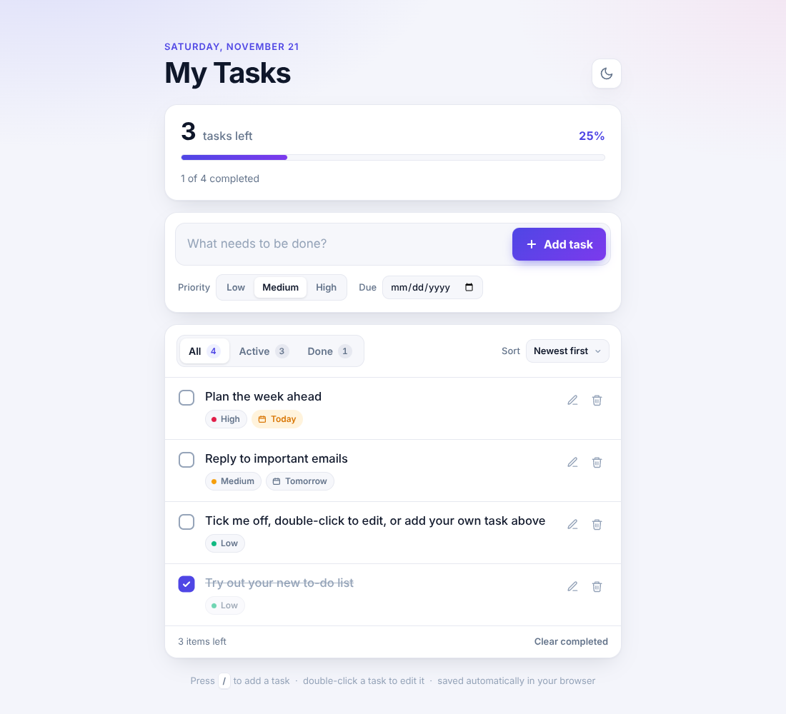
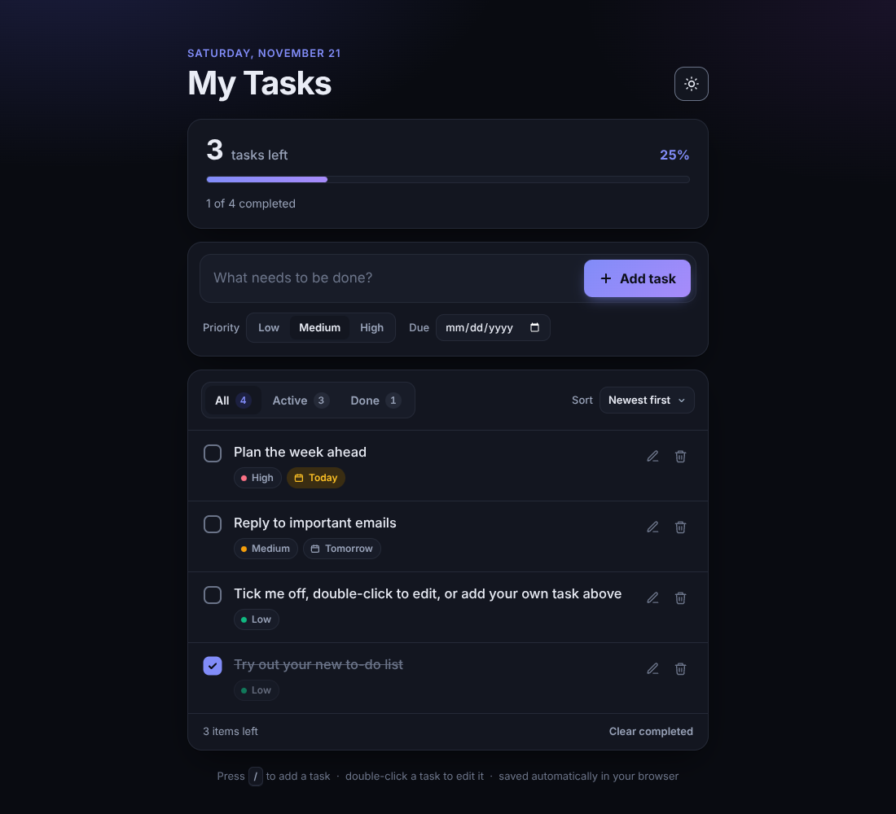

# Tasks — a clean, modern to-do list

A single-page to-do app in **one file** (`index.html`). No build step, no dependencies, no tracking.
Your tasks are saved in your browser (`localStorage`), so they stay on your device.

  
  

## Features

- Add, edit (double-click or the pencil), complete and delete tasks
- **Priority** (Low / Medium / High) and optional **due date** with *Today*, *Tomorrow* and *Overdue* highlighting
- **Filters** (All / Active / Done) with live counts, and **sorting** (newest, oldest, due date, priority)
- **Progress bar** and "tasks left" counter
- **Undo** after deleting a task or clearing completed tasks (button or `Ctrl/Cmd + Z`)
- **Light and dark theme** — follows your system until you pick one
- Responsive (phone, tablet, desktop), keyboard friendly (`/` focuses the input), screen-reader labels, reduced-motion support
- Works offline; keeps several open tabs in sync

## Run it locally

Open `index.html` in a browser. That's it.

## Deploy (about 1 minute) — GitHub Pages

1. Put the files of this folder in the root of your repository (`index.html` is the one that matters) and commit to `main`.
2. In the repository go to **Settings → Pages**.
3. Under **Build and deployment** choose **Source: Deploy from a branch**, then **Branch: `main`** and folder **`/ (root)`**, and press **Save**.
4. After a minute your app is live at `https://<your-username>.github.io/<repository-name>/`
   (for this repository: `https://moza4y.github.io/claude-code/`).

Every later push to `main` redeploys automatically.

### Other one-step options

| Host | How |
|---|---|
| **Netlify** | Drag the folder onto <https://app.netlify.com/drop> |
| **Vercel** | `npx vercel` in the folder (or import the repo) |
| **Cloudflare Pages** | Connect the repo, build command: *none*, output directory: `/` |
| **Any static host / web server** | Upload `index.html` |

All paths are relative, so it works at a sub-path (like GitHub Pages) as well as at a domain root.

## Customise

Everything lives in `index.html`:

- **Colours / look:** edit the CSS variables at the top of the `<style>` block (`--accent`, `--surface`, `--radius`, …). The dark theme is the `[data-theme="dark"]` block.
- **Sample tasks:** the first visit shows a few example tasks. Set `SEED_SAMPLE_TASKS = false` in the script to start empty.
- **Title / text:** change `<title>` and the `<h1>`.

## Privacy

No network requests, no analytics, no cookies. Data is stored only in your browser under the keys `tasks.v1` and `tasks.theme`.
Clearing the site's data in your browser removes it.

## Browser support

Current versions of Chrome, Edge, Firefox and Safari. (Uses CSS variables, `:focus-visible` and `color-mix()`; the last one degrades gracefully.)

## License

MIT — see [LICENSE](LICENSE).
